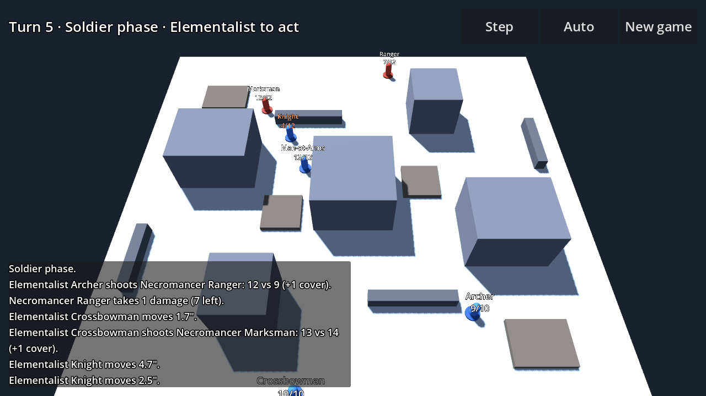

# Frostgame

A Frostgrave (2nd edition) skirmish simulator for Android phones, built with Godot 4.
Fully automated rules on a 3D table; campaign play to follow. Personal project — Frostgrave
belongs to Osprey Games and Joseph A. McCullough, and no rulebook text is included.



**Status:** playable human-vs-bot skirmishes with initial implementations of the core spell, potion and magic gear catalogs, persistent between-battle campaigns, base resources and progression. Rules fidelity, scenario variety and battle save/resume are still in development.

## Run it
1. Install [Godot 4.5+](https://godotengine.org/download) (standard build, not .NET).
2. Open `project.godot` and press Play.
3. You control the blue Elementalist warband. Tap a marked figure to activate it, choose an enabled action, and tap a marked destination or target. Reload and End execute directly. The rival plays automatically.
   - Move marks reachable ground. Fight and Shoot mark legal enemies. Collect, Drop and Exit mark their legal positions.
   - In wizard/apprentice phases you may activate eligible soldiers individually or declare Group before acting. Select up to three soldiers and Start group; complete the movement pass for every member, then their second actions. Pass soldiers leaves optional early activations for later.
   - Watch switches to bot-vs-bot play between activations; Step and Auto are available there. New game restarts.
   - Mouse: click to select, left-drag orbit, right-drag pan, wheel zoom.
   - Touch: tap to select, one-finger drag orbit, two-finger pan, pinch zoom.

## Tests
```sh
godot --headless --import
godot --headless -s tests/run_tests.gd
```

See `CLAUDE.md` for the file map, `docs/rules-coverage.md` for what's implemented and what
still needs checking against the book, and `docs/PLANNING.md` for the roadmap.

## Wizard and magic prototype
Open **Warband** to name a wizard, select a school and eight spells, hire soldiers and start a new skirmish. The budget and specialist cap are validated. Unimplemented spell effects are explicitly marked in the editor. During a caster activation, **Cast** lists usable known spells; choose a target, then choose Health empowerment and resolve the roll. The creature phase and optional treasure encounters are enabled in the default scenario.
